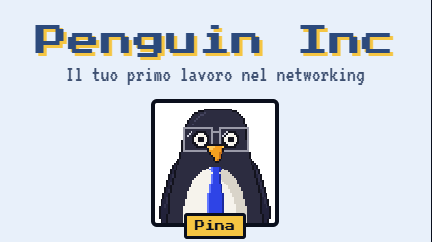
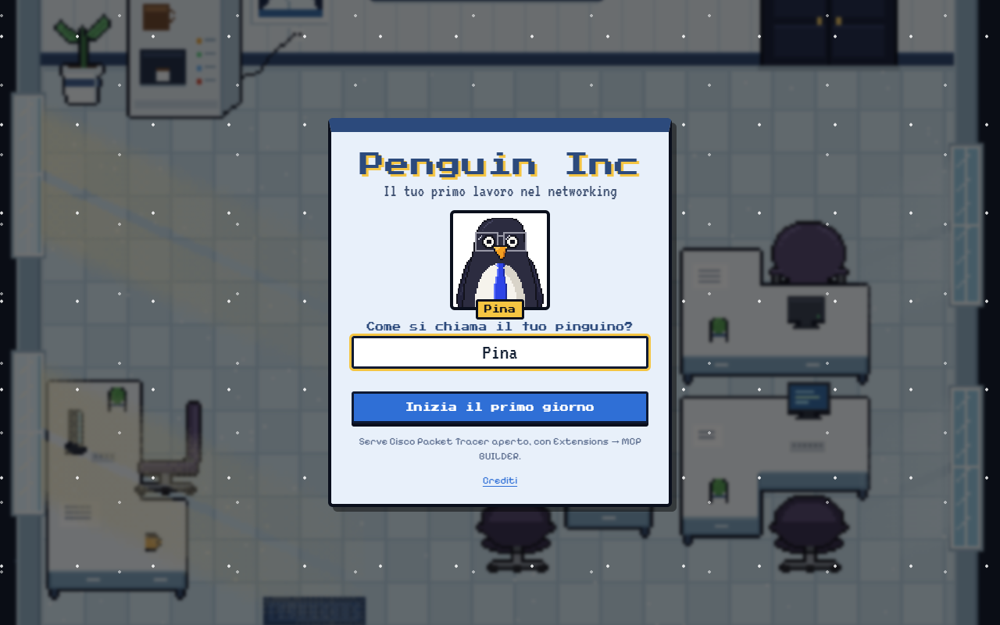
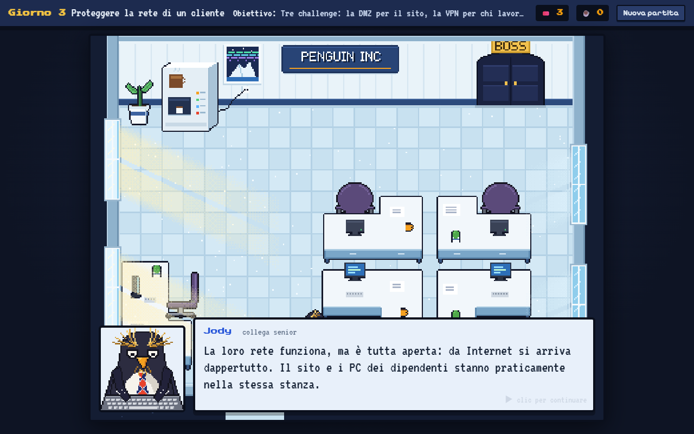
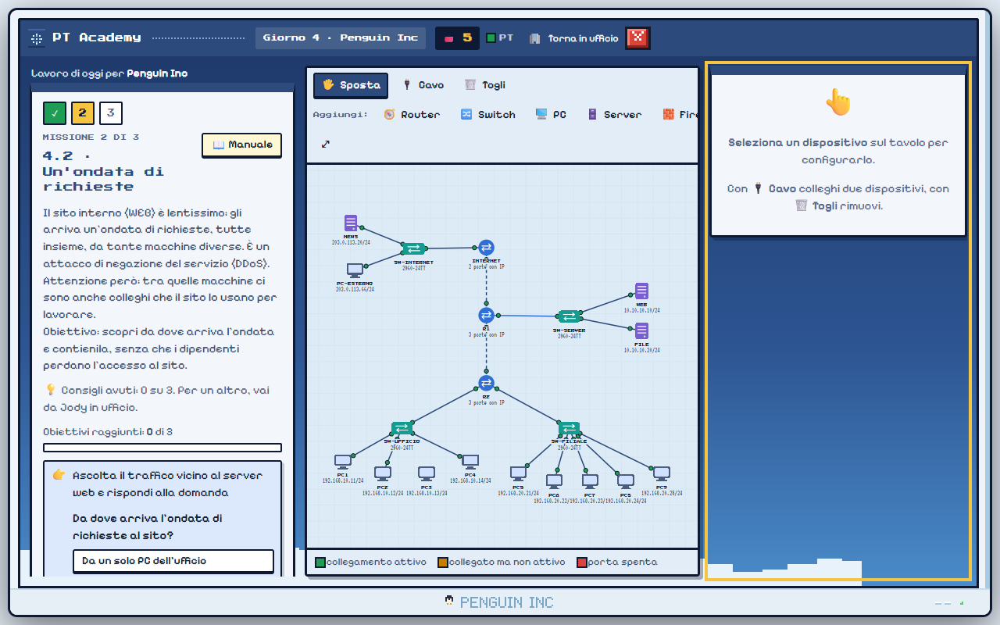
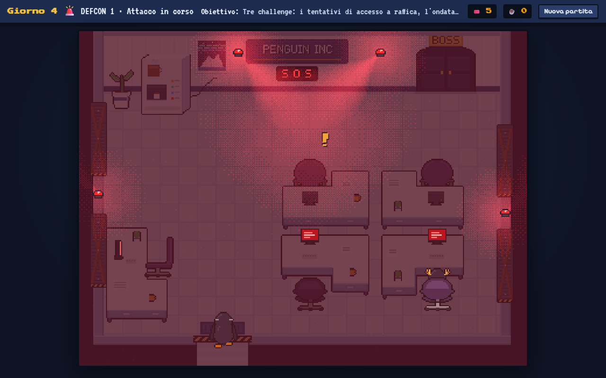
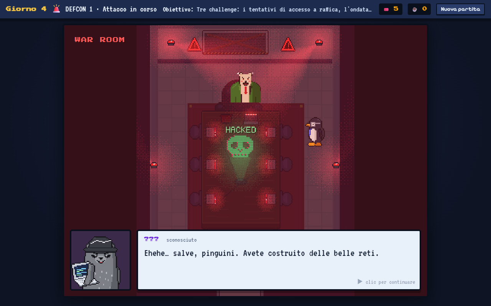
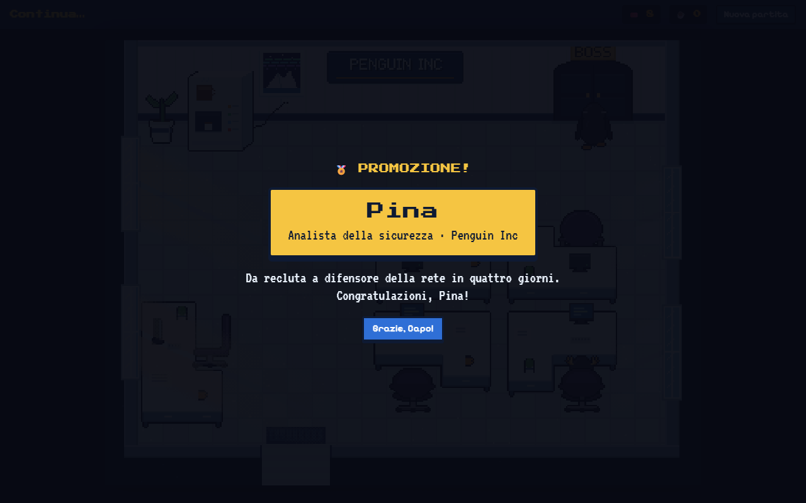

<p align="center">
  
</p>

<p align="center">
  <b>Un serious game sulle reti e la cybersicurezza, dove si gioca su una rete vera di Cisco Packet Tracer.</b><br>
  Progetto in gara a <b>The Big Hack 2026</b> · challenge <b>C4 Consorzio Clara</b> (Cisco Networking Academy)
</p>

---

## The Big Hack 2026

**Penguin Inc** (nel codice *PT Academy*) è il progetto del team **Los Penguinos** per
[The Big Hack 2026](https://go.codemotion.com/big-hack-hackathon-2026/), l'hackathon di **Codemotion × Futuro
Remoto** alla **Città della Scienza di Napoli**, il 14 e 15 novembre 2026.

La challenge **C4 · Consorzio Clara** (Cisco Networking Academy) chiedeva un **serious game educativo sul networking
e la cybersicurezza** per chi è alle prime armi. La nostra risposta è un gioco in cui ogni rete è vera: quello che il
giocatore costruisce nel browser viene creato in Cisco Packet Tracer, e il gioco lo verifica con ping, tracce e
connessioni reali.

## La storia

Sei un pinguino al primo giorno di lavoro a **Penguin Inc**, un'azienda antartica che si occupa di reti e
sicurezza. **Jody**, la collega senior, ti accoglie in ufficio. Ogni giorno ci sono tre *challenge*, e la difficoltà
cresce un po' alla volta. Se ti blocchi, vai da Jody: il primo giorno ti dà consigli gratis, dal secondo li paga
un caffè della macchinetta, comprato con i buoni guadagnati.

<p align="center">
  
  
</p>

Il lavoro si fa al **computer**, cioè un'interfaccia collegata a Packet Tracer. Lì si aggiungono dispositivi e cavi,
si configurano indirizzi, rotte, DHCP, DNS, firewall, ACL e limiti di velocità, si fanno ping e si ascolta il
traffico con uno sniffer. Il pulsante **Verifica** prova il traffico vero sulla rete.

<p align="center">
  
</p>

| Giorno | Tema | Le tre challenge |
|---|---|---|
| 1 | Le prime reti | la prima LAN (tutorial guidato), l'uscita verso l'esterno con un router, due reparti separati |
| 2 | Una sala server | sala server dietro un secondo router con DHCP, nomi al posto degli indirizzi (DNS), firewall con regole per servizio |
| 3 | Proteggere un cliente | una DMZ con due firewall, una sottorete per chi lavora in VPN, i servizi nel cloud dietro un firewall |
| 4 | **DEFCON 1**: attacco in corso | tentativi di accesso a raffica (forza bruta), un'ondata di richieste (DDoS), una *reverse shell* verso l'attaccante |

Il quarto giorno l'ufficio va in allarme: **le foche attaccano**. Il Capo, un orso polare, ti convoca nella
**war room** e a ogni attacco ti spiega, agitatissimo, cosa sta succedendo. Con lo sniffer scopri chi attacca e lo
fermi senza bloccare chi lavora. Alla fine arriva la **promozione**.

<p align="center">
  
  
</p>
<p align="center">
  
</p>

## Perché è utile

- **Niente simulazioni finte.** Le topologie sono vere reti di Packet Tracer, lo strumento che si usa nei corsi
  Cisco Networking Academy. Quello che si impara vale fuori dal gioco.
- **Si impara facendo.** Ogni challenge dice *cosa* ottenere, non *come*: la soluzione la trova il giocatore, con il
  Manuale (la teoria in pillole) e i consigli di Jody, dal più vago al più preciso.
- **Le verifiche controllano il risultato, non la ricetta.** Il gioco riconosce la forma della rete e prova il
  traffico: vale qualsiasi soluzione corretta, con i nomi e gli indirizzi scelti dal giocatore.
- **Dalle basi alla difesa.** Si parte da due PC e uno switch e si arriva a DMZ, VPN, rate limiting e risposta agli
  incidenti.
- **I contenuti si cambiano senza programmare.** Storia, challenge, testi e livelli sono file YAML in
  `frontend/demo/gioco/`.

## Come funziona

```
Browser ──HTTP──▶ server.py ──MCP stdio──▶ packet-tracer-mcp ──bridge :54321──▶ Packet Tracer
```

- **Client** (`frontend/demo/`): l'ufficio in pixel art (`scripts/storia.js`) e il computer collegato alla rete
  (`scripts/app.js`), in HTML, CSS e JavaScript, senza framework.
- **Server** (`backend/server.py`, Python e Starlette): azioni sulla rete, lavori lunghi con avanzamento, verifiche
  e salvataggio della partita.
- **Collegamento a Packet Tracer** (`backend/ptlink.py`): una sessione MCP verso
  [`packet-tracer-mcp`](https://pypi.org/project/packet-tracer-mcp/), che comanda Packet Tracer attraverso
  l'estensione MCP BUILDER.
- **Motore di gioco** (`backend/missions.py`, `rescue.py`, `firewall.py`): controlli sulla forma della rete e
  verifiche sul traffico vero (ping, tracce, porte TCP, risoluzione dei nomi, limiti di velocità).
- **Contenuti** (`frontend/demo/gioco/*.yaml`): la storia, le challenge e i testi; le reti di partenza sono file
  `.pkt` in `gioco/reti/`.

Il motore ha anche un secondo modo di giocare, il **Pronto Soccorso**, disponibile dall'API: il gioco costruisce
una rete, la guasta di proposito e consegna un ticket con i sintomi da riparare.

## Avvio

Serve **Cisco Packet Tracer** aperto con l'estensione **MCP BUILDER** (Extensions → MCP BUILDER) e
[`uv`](https://docs.astral.sh/uv/).

```bash
uv run --directory backend server.py
```

Poi apri http://127.0.0.1:8787. Su macOS basta un doppio clic su
[`Avvia PT Academy.command`](Avvia%20PT%20Academy.command).

- **Senza codice di accesso** il gioco risponde solo a questo computer.
- **Per giocare da altri dispositivi della rete locale** serve un codice:
  `PTA_HOST=0.0.0.0 PTA_CODE=scegli-un-codice uv run --directory backend server.py`, poi si apre
  `http://<IP di questo computer>:8787`. Usa un codice lungo: chi lo conosce comanda il tuo Packet Tracer (solo
  dentro la simulazione).
- **Modalità collaudo** (`PTA_COLLAUDO=1`): cheat per provare il gioco (salta una challenge, vai a un giorno,
  buoni caffè). Non va usata in una demo pubblica.
- La partita è salvata in `backend/data/state.json`, fuori da git: cancellalo a server fermo per ripartire da zero.
- Le challenge che partono da una rete preparata la aprono in Packet Tracer al posto di quella aperta: salva prima
  il tuo lavoro.

Copione della demo per la giuria e soluzione dei problemi più comuni: [DEMO.md](DEMO.md).

## Documentazione

- [DEMO.md](DEMO.md): checklist, copione della demo, cosa fare se qualcosa va storto.
- [frontend/demo/README.md](frontend/demo/README.md): il client, la storia di Penguin Inc e come cambiare i contenuti.
- [backend/docs/API.md](backend/docs/API.md): l'API HTTP, endpoint per endpoint.
- [backend/docs/ARCHITETTURA.md](backend/docs/ARCHITETTURA.md): come funziona dentro, come aggiungere challenge e
  livelli, e le trappole di Packet Tracer che abbiamo incontrato e misurato.

## Team

**Los Penguinos**: [Pasquale Criscuolo](https://github.com/Paki64), [Giovanni Di Stazio](https://github.com/giovannids100),
[Francesca Morra](https://github.com/fra494).

## Crediti

Musica: «Stumble Around» e «Face the Facts» di Zane Little, dall'album
[*A Bag of Chips [Vol. 1]*](https://zanelittle.bandcamp.com/album/a-bag-of-chips-vol-1) (2022), licenza
[CC BY 4.0](https://creativecommons.org/licenses/by/4.0/deed.it). Dettagli in [`CREDITI.md`](CREDITI.md).

Cisco e Packet Tracer sono marchi di Cisco Systems, Inc. Questo progetto non è affiliato a Cisco: usa Packet Tracer
come strumento, e le challenge sono scritte da noi.
